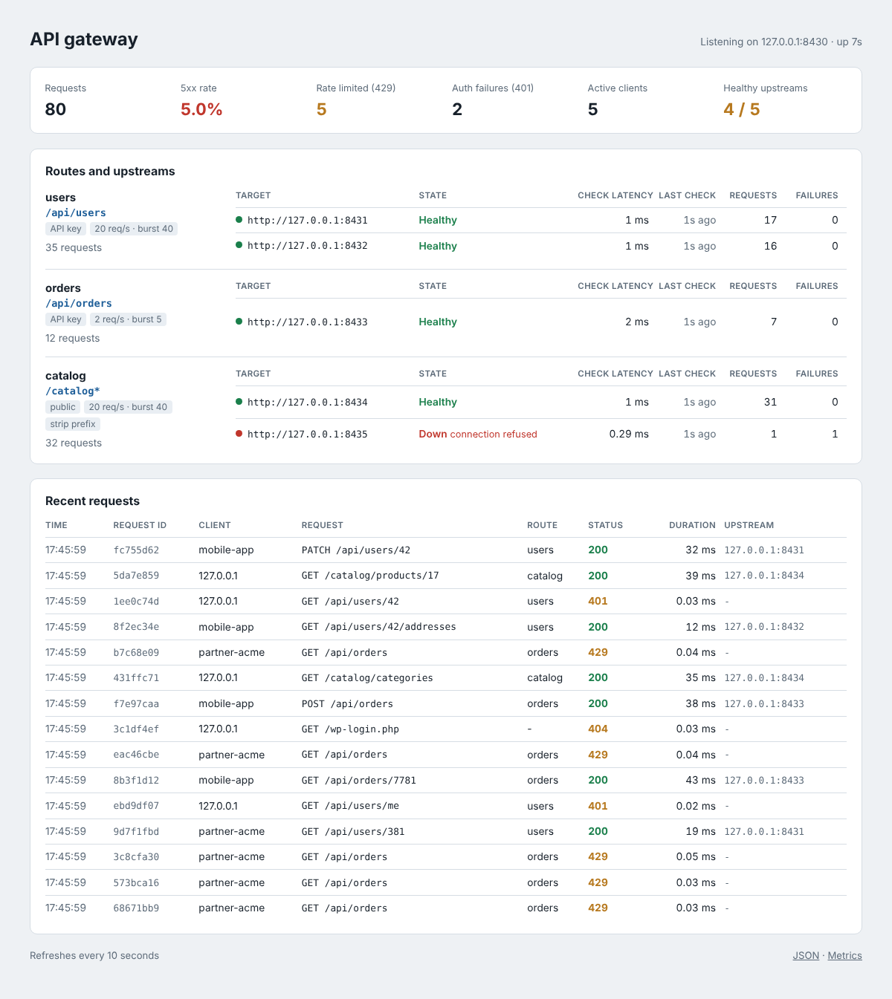

# API gateway (Go)

A small API gateway in a single Go binary with no dependencies outside the standard library. It sits
in front of your services, routes requests by path prefix, checks API keys, applies per-client rate
limits, spreads traffic over healthy upstreams and gives you access logs, Prometheus metrics and a
status page. Useful for small platforms that need these basics without running Kong or Envoy.



## Features

- Routing by path prefix (longest prefix wins, matched on segment boundaries), optional
  `strip_prefix`, built on `net/http/httputil.ReverseProxy` with `X-Forwarded-*` headers.
- API keys via `X-API-Key` or `Authorization: Bearer`; the key is removed before proxying and the
  upstream receives the client name in `X-Gateway-Client`. Routes can be `public`.
- Token bucket rate limiting per client (API key name, or IP for public routes), global or per route,
  with `X-RateLimit-Limit`, `X-RateLimit-Remaining` and `Retry-After` on `429`.
- Upstream health checks (`GET /healthz` by default) with thresholds, round-robin over healthy
  targets, passive failure detection on proxy errors, `503` when nothing is healthy.
- `X-Request-ID` kept from the client (when valid) or generated, sent upstream and returned.
- JSON access logs with `log/slog`: request ID, client, route, status, bytes, duration, upstream.
- Admin listener (private): status page, `/api/status`, `/metrics` (`gateway_requests_total`,
  `gateway_request_duration_seconds`, `gateway_rate_limited_total`, `gateway_auth_failures_total`,
  `gateway_upstream_errors_total`, `gateway_upstream_up`) and `/healthz`.
- Graceful shutdown: in-flight requests finish on SIGTERM.

## How to use

```bash
cp config.example.json config.json    # set your upstreams and API keys
go run .                              # public :8080, admin :9090
go test -race ./...                   # config, rate limiter, health checks, proxy and admin tests
```

```json
{
  "listen": ":8080",
  "admin_listen": "127.0.0.1:9090",
  "trust_proxy": false,
  "rate_limit": { "rps": 10, "burst": 20 },
  "api_keys": [{ "name": "mobile-app", "key": "a-long-random-secret-key" }],
  "routes": [
    { "name": "users", "prefix": "/api/users", "upstreams": ["http://users-1:8000", "http://users-2:8000"],
      "health_check": { "path": "/healthz", "interval": "5s", "timeout": "2s", "unhealthy_after": 2 } },
    { "name": "orders", "prefix": "/api/orders", "upstreams": ["http://orders:8000"],
      "rate_limit": { "rps": 2, "burst": 5 } },
    { "name": "catalog", "prefix": "/catalog", "strip_prefix": true, "public": true,
      "upstreams": ["http://catalog:8000"] }
  ]
}
```

Set `trust_proxy` to `true` only behind a load balancer that sets `X-Forwarded-For`; otherwise
clients could choose their own rate-limit bucket.

Requests:

```bash
curl -i -H 'X-API-Key: a-long-random-secret-key' localhost:8080/api/users/42
# HTTP/1.1 200 OK
# X-Ratelimit-Limit: 20
# X-Ratelimit-Remaining: 19
# X-Request-Id: f2ec0aed24d1e6c2a523e788

curl -i localhost:8080/api/users/42                    # 401 {"error":"missing or invalid API key","request_id":"..."}
curl -i localhost:8080/catalog/products/7              # public route, upstream sees /products/7
curl -s localhost:9090/metrics | grep gateway_upstream_up
open http://localhost:9090/                            # status page
```

Access log line:

```json
{"time":"2026-10-12T17:45:21-03:00","level":"INFO","msg":"request","request_id":"f2ec0aed24d1e6c2a523e788","client":"mobile-app","method":"GET","path":"/api/users/42","route":"users","status":200,"bytes":43,"duration_ms":6.564,"upstream":"127.0.0.1:8432"}
```

Docker:

```bash
docker build -t api-gateway .
docker run -p 8080:8080 -p 127.0.0.1:9090:9090 -v $PWD/config.json:/config.json api-gateway
```

**Stack:** Go 1.23 standard library (`net/http/httputil`, `log/slog`, `html/template`, `embed`,
`crypto/sha256`).

## Em português

Gateway de API pequeno, em um único binário Go e sem dependências externas. Fica na frente dos seus
serviços e faz o básico que toda API precisa: roteamento por prefixo de caminho, autenticação por
chave de API, limite de requisições por cliente (token bucket), balanceamento round-robin entre os
servidores saudáveis com health check, ID de requisição, logs de acesso em JSON, métricas para o
Prometheus e uma página de status com as rotas, a saúde de cada upstream e as últimas requisições.

Como usar:

```bash
cp config.example.json config.json   # configure rotas, upstreams e chaves de API
go run .                             # tráfego em :8080, página de status e métricas em :9090
go test -race ./...                  # roda os testes

curl -H 'X-API-Key: sua-chave' localhost:8080/api/users/42
```

Com Docker: `docker build -t api-gateway .` e
`docker run -p 8080:8080 -p 127.0.0.1:9090:9090 -v $PWD/config.json:/config.json api-gateway`.
Deixe a porta de administração (9090) acessível apenas pela rede interna.
