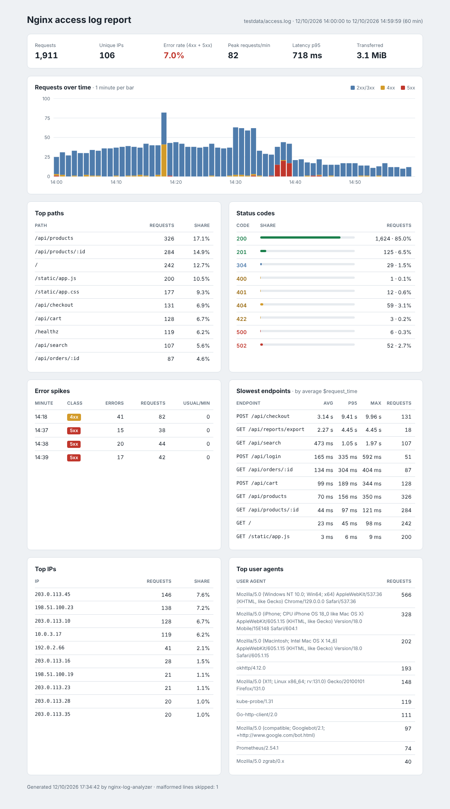

# Nginx log analyzer (Go)

A command-line tool that streams Nginx access logs and tells you what happened: busiest paths,
status codes, traffic per minute, slowest endpoints, top clients and minutes where 4xx or 5xx errors
spiked. It reads plain or gzipped files and stdin, keeps memory flat on large files, and prints a
terminal table, JSON for scripts, or a single self-contained HTML report you can attach to an
incident ticket. No dependencies outside the Go standard library.



## Features

- Parses the `combined` log format, with or without `$request_time` at the end (bare number or
  `rt=0.123`, as in common `log_format` variants). Malformed lines are counted and skipped.
- Gzip is detected from the content, so rotated `access.log.2.gz` files and pipes both work;
  several files are merged into one report.
- Top paths (IDs such as `/orders/42` or UUIDs collapsed into `/orders/:id`), status code
  distribution, requests per minute with peak and average, top IPs and user agents.
- Slowest endpoints by average `$request_time`, with p95 and max (p95 from a log-scale histogram,
  within 10%, so memory does not grow with the number of lines).
- Error spikes: minutes where 4xx or 5xx responses are above a minimum and several times the median.
- Output as a table, JSON or an HTML report with inline CSS and SVG (no external requests).

## How to use

```bash
go run . testdata/access.log                         # table in the terminal
go run . -format json /var/log/nginx/access.log > report.json
go run . -format html -o report.html /var/log/nginx/access.log*   # plain and .gz files together
zcat access.log.*.gz | go run .                       # or read from stdin
go test -race ./...                                   # parser, analysis, output and CLI tests
```

| Flag | Default | Meaning |
| --- | --- | --- |
| `-format` | `table` | `table`, `json` or `html` |
| `-o` | stdout | write the report to a file |
| `-top` | `10` | rows in each top list |
| `-raw-paths` | `false` | keep paths as they are (no `:id` collapsing) |
| `-spike-min` | `10` | minimum 4xx or 5xx responses in a minute to call it a spike |
| `-spike-factor` | `3` | how many times the median errors per minute a spike must reach |

To get the latency section, add `$request_time` to the end of your log format:

```nginx
log_format timed '$remote_addr - $remote_user [$time_local] "$request" $status $body_bytes_sent '
                 '"$http_referer" "$http_user_agent" $request_time';
access_log /var/log/nginx/access.log timed;
```

Example output (from `testdata/access.log`, one hour of synthetic traffic):

```text
Requests      1,911 (malformed lines skipped: 1)
Status        2xx 1,749 · 3xx 29 · 4xx 75 · 5xx 58 (error rate 7.0%)
Requests/min  average 31.9, peak 82 at 14:18
Latency       p50 41 ms · p95 718 ms

SLOWEST ENDPOINTS (by average $request_time)
  AVG     P95     MAX     REQUESTS  ENDPOINT
  3.14 s  9.41 s  9.96 s  131       POST /api/checkout
  2.27 s  4.45 s  4.45 s  18        GET /api/reports/export

ERROR SPIKES
  MINUTE       CLASS  ERRORS  OF REQUESTS  USUAL/MIN
  12/10 14:18  4xx    41      82           0
  12/10 14:38  5xx    20      44           0
```

Docker (mount the log directory):

```bash
docker build -t nginx-log-analyzer .
docker run --rm -v /var/log/nginx:/logs:ro nginx-log-analyzer access.log
docker run --rm -i nginx-log-analyzer -format json < access.log
```

**Stack:** Go 1.23 standard library (`bufio`, `compress/gzip`, `text/tabwriter`, `html/template`,
`embed`).

## Em português

Ferramenta de linha de comando que lê logs de acesso do Nginx (formato `combined`, arquivos normais
ou `.gz`, ou pela entrada padrão) e mostra o que aconteceu: caminhos mais acessados, distribuição
de status HTTP, requisições por minuto, endpoints mais lentos (quando o log tem `$request_time`),
IPs e user agents que mais acessam e os minutos com picos de erros 4xx e 5xx. A saída pode ser uma
tabela no terminal, JSON ou um relatório HTML completo em um único arquivo.

Como usar:

```bash
go run . testdata/access.log                                   # tabela no terminal
go run . -format html -o relatorio.html /var/log/nginx/access.log*
zcat access.log.*.gz | go run . -format json                   # lendo da entrada padrão
go test -race ./...                                            # roda os testes
```

Com Docker: `docker build -t nginx-log-analyzer .` e
`docker run --rm -v /var/log/nginx:/logs:ro nginx-log-analyzer access.log`.
