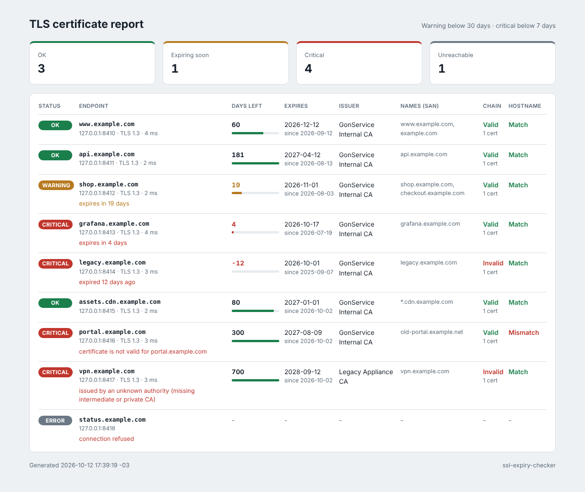

# SSL expiry checker (Go)

Checks the TLS certificates of many endpoints at once and tells you which ones expire soon, have a
broken chain or do not match the hostname. Use it as a CLI in CI (exit codes for warning and
critical), as a cron job that writes an HTML report, or as a small daemon that Prometheus scrapes.
A single Go binary with no dependencies outside the standard library.



## Features

- Concurrent checks with a worker pool and a connect and handshake timeout per endpoint.
- For each certificate: days left, expiry and start dates, issuer, SANs, TLS version, latency.
- Chain validation against the system roots (plus your private CAs with `-ca-file`); expired,
  self-signed and unknown-authority certificates are still inspected and reported, not just rejected.
- Hostname check against the SNI name, wildcards included. `name@host:port` checks one backend
  behind a load balancer with the public name.
- Warning and critical thresholds in days; exit code `0` ok, `1` warning, `2` critical or
  unreachable, `3` usage error.
- Output as a table, JSON or a self-contained HTML report.
- Daemon mode: rechecks on an interval and serves `/metrics` (`ssl_cert_expiry_days`,
  `ssl_cert_not_after_timestamp_seconds`, `ssl_cert_chain_valid`, `ssl_cert_hostname_match`,
  `ssl_check_success`, `ssl_check_duration_seconds`), `/api/results` and an HTML page.
- Tests run local TLS servers (`httptest.NewTLSServer`) with certificates generated by `crypto/x509`:
  no internet needed.

## How to use

```bash
go run . example.com github.com:443                   # table, exit code for CI
go run . -f targets.example.txt -warn 30 -crit 7      # list of endpoints
go run . -f targets.txt -format json > certs.json
go run . -f targets.txt -format html -o certs.html
go run . -ca-file internal-ca.pem intranet.example.com
go run . -daemon -addr :9115 -interval 1h -f targets.txt   # Prometheus at :9115/metrics
go test -race ./...
```

| Flag | Default | Meaning |
| --- | --- | --- |
| `-f` | | file with one target per line (`#` comments) |
| `-warn` / `-crit` | `30` / `7` | thresholds in days |
| `-timeout` | `5s` | connect and handshake timeout per endpoint |
| `-workers` | `8` | endpoints checked in parallel |
| `-format` / `-o` | `table` / stdout | `table`, `json` or `html`, optional output file |
| `-ca-file` | | PEM with extra trusted CAs |
| `-daemon`, `-addr`, `-interval` | off, `:9115`, `1h` | daemon mode |

Targets: `example.com` (port 443), `example.com:8443`, `[2001:db8::1]:443`, or
`www.example.com@10.0.0.5:443` to connect to an address but send and verify another name.

Example output (the screenshot above, generated against local test servers):

```text
STATUS    TARGET                                 DAYS  EXPIRES     ISSUER                  CHAIN    HOST      NOTES
OK        www.example.com@127.0.0.1:8410         60    2026-12-12  GonService Internal CA  valid    match
WARNING   shop.example.com@127.0.0.1:8412        19    2026-11-01  GonService Internal CA  valid    match     expires in 19 days
CRITICAL  legacy.example.com@127.0.0.1:8414      -12   2026-10-01  GonService Internal CA  invalid  match     expired 12 days ago
CRITICAL  portal.example.com@127.0.0.1:8416      300   2027-08-09  GonService Internal CA  valid    MISMATCH  certificate is not valid for portal.example.com
ERROR     status.example.com@127.0.0.1:8418      -     -           -                       -        -         connection refused
```

In a pipeline:

```yaml
- name: Check certificates (fail only on critical)
  run: ssl-expiry-checker -warn 30 -crit 14 -f targets.txt || [ $? -eq 1 ]
```

Prometheus alert:

```yaml
- alert: CertificateExpiresSoon
  expr: ssl_cert_expiry_days < 14
  labels: { severity: warning }
```

Docker:

```bash
docker build -t ssl-expiry-checker .
docker run --rm ssl-expiry-checker example.com
docker run -p 9115:9115 -v $PWD/targets.txt:/targets.txt ssl-expiry-checker -daemon -f /targets.txt
```

**Stack:** Go 1.23 standard library (`crypto/tls`, `crypto/x509`, `net/http`, `html/template`,
`embed`, `log/slog`).

## Em português

Verifica os certificados TLS de vários endereços ao mesmo tempo e mostra quantos dias faltam para
vencer, quem emitiu, os nomes (SAN), se a cadeia é válida e se o certificado corresponde ao nome do
host. Funciona como CLI em pipelines de CI (código de saída 1 para aviso e 2 para crítico), gera
relatório em tabela, JSON ou HTML, e tem um modo daemon que expõe métricas para o Prometheus
(`ssl_cert_expiry_days`) para alertar antes de um certificado vencer.

Como usar:

```bash
go run . exemplo.com.br api.exemplo.com.br:8443            # tabela no terminal
go run . -f alvos.txt -warn 30 -crit 7 -format html -o certificados.html
go run . -daemon -addr :9115 -interval 1h -f alvos.txt     # métricas em :9115/metrics
go test -race ./...                                        # testes com servidores TLS locais
```

Com Docker: `docker build -t ssl-expiry-checker .` e `docker run --rm ssl-expiry-checker exemplo.com.br`.
