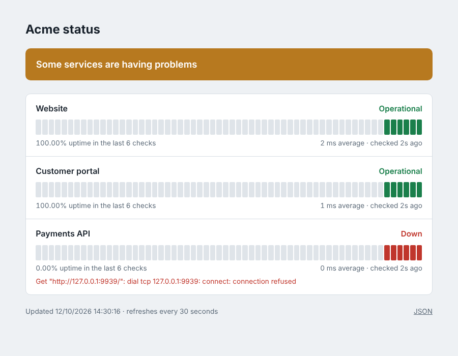

# Status page (Go)

A public status page in a single Go binary with no dependencies outside the standard library.
It checks your sites and APIs on a schedule, shows the last 60 checks per service, and exposes a
JSON API and Prometheus metrics. The Docker image is a few megabytes on distroless.



## Features

- HTTP checks per service with their own interval, timeout and optional expected status code.
- Overall state: operational, degraded or down; page refreshes every 30 seconds.
- `GET /api/status` (JSON, CORS enabled) to embed the status in another site.
- `GET /metrics` for Prometheus: `status_page_up`, `status_page_latency_seconds`,
  `status_page_checks_total`, `status_page_failures_total`.
- Security headers with a strict Content Security Policy, graceful shutdown, structured JSON logs.

## Run

```bash
cp config.example.json config.json    # list your services
go run .                              # http://localhost:8080
go test -race ./...                   # monitor, config and HTTP tests
```

Docker: `docker build -t status-page . && docker run -p 8080:8080 -v $PWD/config.json:/config.json status-page`

```json
{
  "title": "Acme status",
  "services": [
    { "name": "Website", "url": "https://example.com", "interval": "30s" },
    { "name": "API", "url": "https://api.example.com/health", "interval": "60s", "timeout": "5s", "expected_status": 200 }
  ]
}
```

**Stack:** Go 1.23 standard library (`net/http` routing, `html/template`, `embed`, `log/slog`).

## Em português

Página de status pública em um único binário Go, sem dependências externas: verifica sites e APIs
periodicamente, mostra o histórico das últimas 60 verificações de cada serviço e oferece API JSON e
métricas para o Prometheus. A imagem Docker tem poucos megabytes.
