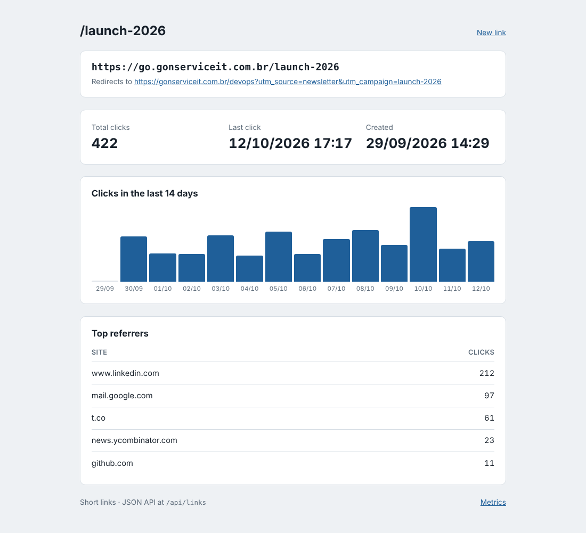

# URL shortener (Go)

A self-hosted URL shortener in a single Go binary with no dependencies outside the standard library.
Create short links from a small web form or a JSON API, pick a custom alias, and follow every link's
clicks per day and top referrers. Links live in a JSON file written atomically, so there is no
database to run. The Docker image is a few megabytes on distroless.



## Features

- Web form and JSON API (`POST /api/links`) to create links, with optional custom alias
  (3-32 characters: letters, digits, `-`, `_`); random 7-character codes otherwise.
- URL validation: only absolute `http`/`https` URLs with a host, no embedded credentials, max 2048 bytes.
- `GET /{code}` redirects (302) and counts the click, the day and the referrer host.
- Stats page per link (`/{code}/stats`) with the last 14 days and top referrers
  ([form and recent links](docs/url-shortener-form.png)).
- Persistence to a JSON file: every write goes to a temporary file that is renamed over the old one,
  guarded by a mutex; click counters are flushed every few seconds and on shutdown.
- `GET /metrics` for Prometheus: `shortener_links`, `shortener_clicks`, `shortener_links_created_total`,
  `shortener_redirects_total`, `shortener_not_found_total`.
- Graceful shutdown on SIGINT/SIGTERM, structured JSON logs, strict Content Security Policy.

## How to use

```bash
go run .                                   # http://localhost:8080, data in data/links.json
go run . -addr :9000 -data /var/lib/short/links.json -base-url https://go.example.com
go test -race ./...                        # store and HTTP tests
```

| Flag | Env | Default | Meaning |
| --- | --- | --- | --- |
| `-addr` | `ADDR` | `:8080` | listen address |
| `-data` | `DATA_FILE` | `data/links.json` | JSON file with the links (empty keeps them in memory) |
| `-base-url` | `BASE_URL` | request host | public base used to build short links |
| `-flush` | | `5s` | how often click counters are written to disk |

Docker:

```bash
docker build -t url-shortener .
docker run -p 8080:8080 -v short-data:/data -e BASE_URL=https://go.example.com url-shortener
```

API:

```bash
curl -s -X POST localhost:8080/api/links -d '{"url":"https://example.com/pricing","alias":"pricing"}'
# {"code":"pricing","short_url":"http://localhost:8080/pricing","url":"https://example.com/pricing", ...}

curl -si localhost:8080/pricing | head -n 3     # HTTP/1.1 302 Found, Location: https://example.com/pricing
curl -s localhost:8080/api/links/pricing        # clicks, last_click, daily, referrers
curl -s localhost:8080/api/links                # all links, newest first
curl -s localhost:8080/metrics
```

Errors come back as JSON with the right status: `400` for an invalid URL or alias, `409` when the
alias is taken, `404` for unknown codes.

**Stack:** Go 1.23 standard library (`net/http` method patterns, `html/template`, `embed`, `log/slog`,
`crypto/rand`).

## Em português

Encurtador de URLs auto-hospedado em um único binário Go, sem dependências externas. Você cria links
curtos pelo formulário web ou pela API JSON, pode escolher um apelido (alias) e acompanha os cliques
por dia e os sites de origem de cada link. Os dados ficam em um arquivo JSON gravado de forma atômica
(arquivo temporário + rename), então não há banco de dados para manter.

Como usar:

```bash
go run .                                   # abre em http://localhost:8080
go run . -data /caminho/links.json -base-url https://go.suaempresa.com.br
go test -race ./...                        # roda os testes

# criar um link pela API
curl -s -X POST localhost:8080/api/links -d '{"url":"https://example.com","alias":"site"}'
```

Com Docker: `docker build -t url-shortener .` e
`docker run -p 8080:8080 -v short-data:/data url-shortener`. As métricas para o Prometheus ficam em
`/metrics` e a página de estatísticas de cada link em `/<código>/stats`.
